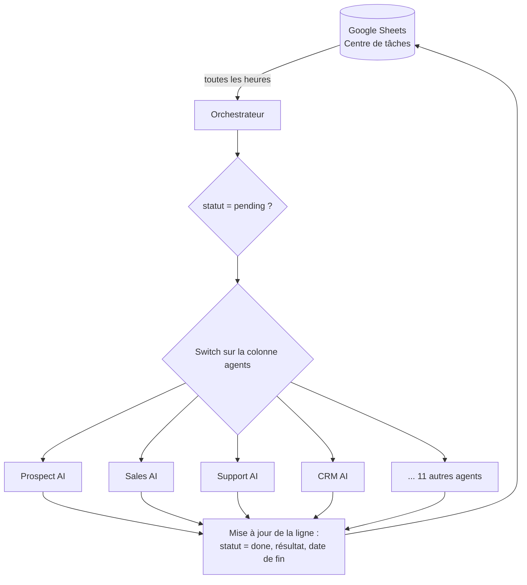

# Système multi-agents pour une petite agence (n8n + Claude)

Quinze agents spécialisés, un par fonction de l'entreprise (ventes, support, marketing, finances, RH, juridique, CRM, analytique…), pilotés par un orchestrateur et alimentés par une simple feuille Google Sheets. Je l'ai construit pour faire tourner Cadence Numérique, ma firme d'automatisation : je dépose une tâche dans la feuille, le bon agent la traite, et le résultat revient dans la même ligne.

## Fonctionnement

La feuille contient une ligne par tâche : `id`, `agents`, `taches`, `priorite`, `output_type`, `statut`, `resultats`, `date_creation`, `date_fin`, `erreur`. Toutes les heures, l'orchestrateur lit les lignes au statut `pending`, appelle le sous-workflow de l'agent nommé dans la colonne `agents`, puis écrit le résultat et passe la ligne à `done`.

Chaque agent reçoit le même gabarit de mission (tâche, priorité, type de résultat attendu, et la consigne de dire clairement quand une demande sort de son rôle au lieu d'inventer).

## Les agents

| Agent | Type | Outils |
|---|---|---|
| Prospect AI | Code déterministe | Recherche SerpAPI, puis fiches prospects dédoublonnées et notées |
| Sales AI | Code déterministe | Message de prospection, relances J+3 et J+7, réponses aux objections |
| Support AI | Claude | Déclenché aussi par courriel (IMAP) ; classe la demande et envoie un brouillon de réponse à valider |
| CRM AI | Claude | HubSpot en lecture, et mise à jour d'une entreprise selon un protocole en deux étapes |
| Analytics AI | Claude | HubSpot (opportunités) en lecture seule, indicateurs du pipeline |
| Research AI | Claude | SerpAPI, 3 recherches au maximum, sources citées |
| Marketing AI, Social AI, Content Factory AI | Claude | SerpAPI pour vérifier tendances et chiffres |
| Direction, Projets, Finance, RH, Juridique, Automation AI | Claude | Aucun outil externe : rédaction et analyse |

`99-socle-agents` est un assistant conversationnel de base (déclencheur de chat), indépendant de l'orchestrateur.

## Choix de conception

- **Du code là où un modèle n'apporte rien.** Prospect AI et Sales AI sont écrits en JavaScript, sans modèle de langage : la recherche, le dédoublonnage et les gabarits de messages donnent un résultat stable et gratuit. Les modèles servent là où il faut comprendre ou rédiger.
- **Validation humaine partout où il y a un effet externe.** Aucun agent n'envoie de courriel, ne publie, ne crée d'opportunité ni ne paie quoi que ce soit. Ils préparent des brouillons ; je valide.
- **Écriture dans le CRM sous contrôle.** CRM AI fonctionne en lecture seule par défaut. Pour modifier une entreprise dans HubSpot, il doit d'abord présenter la valeur actuelle et la nouvelle valeur, attendre une confirmation explicite, relire la fiche avant d'écrire, puis relire après pour vérifier. Il ne doit jamais vider un champ ni réessayer seul après un échec. Son prompt traite aussi le contenu de HubSpot comme des données, jamais comme des instructions.
- **Bornes contre les boucles.** Les agents qui cherchent sur le web sont limités à 3 recherches non répétées, puis doivent livrer avec ce qu'ils ont, en signalant ce qui manque.
- **Pas de chiffres inventés.** Chaque prompt interdit d'inventer statistiques, témoignages ou clients, et demande de distinguer les faits des hypothèses.
- **Loi 25 et LPRPDE.** Rappelées dans chaque prompt : minimisation des données, anonymisation des cas clients.

## Installation

1. Importer les fichiers du dossier `workflows/` dans n8n.
2. Reconnecter les identifiants (Anthropic, SerpAPI, HubSpot, Google Sheets, IMAP/SMTP) : ils ne sont pas inclus.
3. Créer la feuille Google Sheets avec les colonnes ci-dessus et remplacer `REMPLACER_PAR_ID_GOOGLE_SHEET` dans l'orchestrateur.
4. Dans l'orchestrateur, resélectionner chaque sous-workflow dans les nœuds « Run … AI » : les identifiants internes changent à l'import.

## Limites connues

- Si un agent échoue, la ligne reste à `pending` et la colonne `erreur` n'est pas remplie : il manque une branche de gestion d'erreur dans l'orchestrateur.
- Le déclenchement toutes les heures convient à des tâches de fond, pas à des demandes urgentes.
- La mémoire de conversation est indexée par ligne de la feuille ; deux tâches distinctes ne partagent pas de contexte.

## Technologies

n8n (Execute Workflow, Switch, nœuds LangChain), Claude Sonnet 4.6 d'Anthropic (même modèle pour tous les agents), SerpAPI, HubSpot, Google Sheets, IMAP/SMTP.
